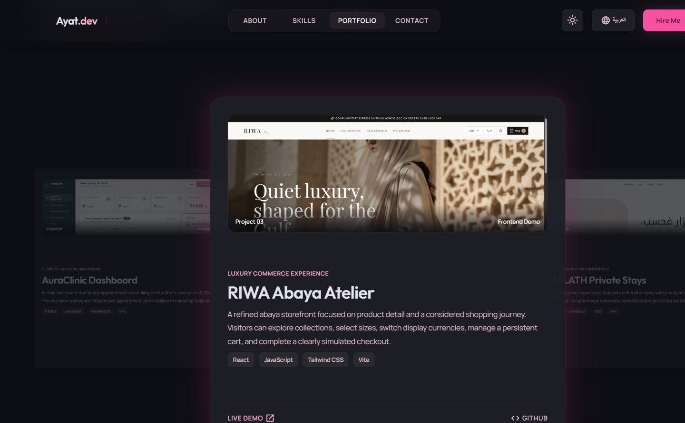

# Ayat Nassar — Front-End Engineer & UI/UX Portfolio

A bilingual portfolio presenting seven interactive front-end projects through real interface previews, concise case-study descriptions, technology summaries, and direct links to live demos and source repositories.

[Visit the portfolio](https://eng-ayatnassar.github.io/)



## Selected work

- [NAWAH Tech Academy](https://eng-ayatnassar.github.io/nawah-tech-academy/) · [source](https://github.com/eng-ayatnassar/nawah-tech-academy)
- [AuraClinic Dashboard](https://eng-ayatnassar.github.io/auraclinic-dashboard/) · [source](https://github.com/eng-ayatnassar/auraclinic-dashboard)
- [RIWA Abaya Atelier](https://eng-ayatnassar.github.io/riwa-abaya-store/) · [source](https://github.com/eng-ayatnassar/riwa-abaya-store)
- [MALATH Private Stays](https://eng-ayatnassar.github.io/malath-villa-booking/) · [source](https://github.com/eng-ayatnassar/malath-villa-booking)
- [RASHFA Specialty Coffee](https://eng-ayatnassar.github.io/rashfa-coffee/) · [source](https://github.com/eng-ayatnassar/rashfa-coffee)
- [Rythm Habit Tracker](https://eng-ayatnassar.github.io/rythm-habit-tracker/) · [source](https://github.com/eng-ayatnassar/rythm-habit-tracker)
- [TaskFlow AI Workspace](https://eng-ayatnassar.github.io/taskflow-saas/) · [source](https://github.com/eng-ayatnassar/taskflow-saas)

## Stack

React · JavaScript · Tailwind CSS · Vite. The original visual design is retained inside a same-origin iframe, with its Tailwind stylesheet compiled locally during the build rather than loaded from the Tailwind CDN.

## Run locally

Use Node.js 22.12 or newer.

```bash
npm ci
npm run dev
```

## Build and deploy

```bash
npm run build
npm run preview
```

GitHub Actions builds and deploys pushes to main with GitHub Pages. The project gallery supports Arabic/English, mobile layouts, local light/dark preferences, and keyboard-operated carousel controls. Preview images are bundled locally.

## Scope

The seven projects are Frontend Demos; backend services and real transactions are not represented as working integrations. The inquiry form prepares a draft in the visitor's email app; the visitor completes sending there. No email is automatically sent by a backend. Direct contact links remain available. Resume download is not available until a PDF is provided.
